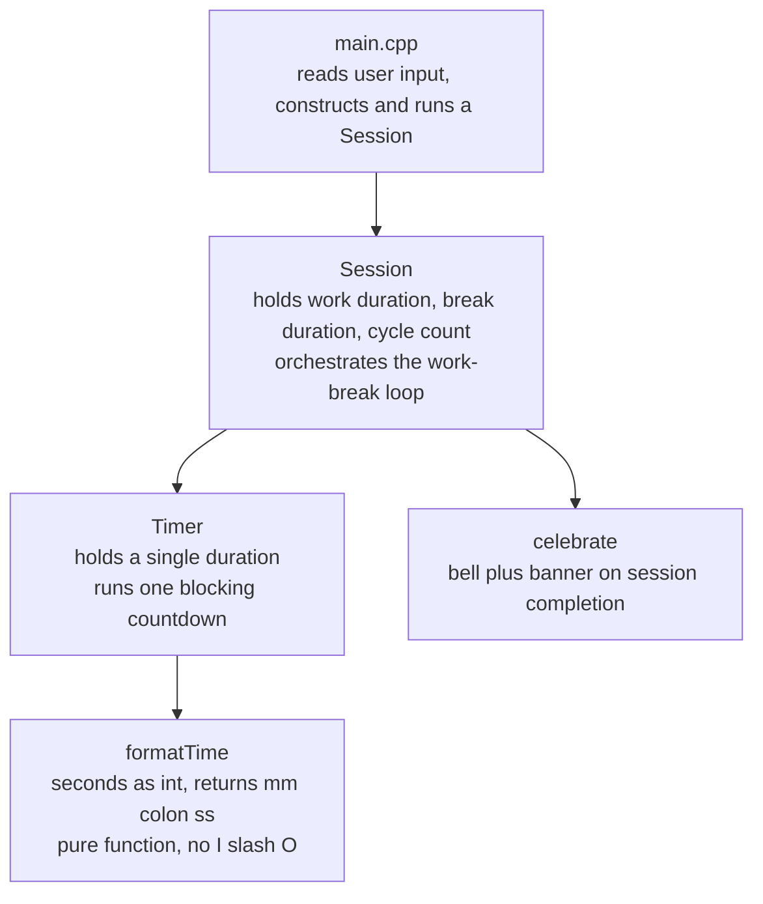

# pomoCLI

A lightweight, dependency-free terminal-based Pomodoro and focus timer, written in C++17. It prompts for a work duration, a break duration, and a number of cycles, then runs an interactive countdown directly in the terminal — redrawing the clock in place each second — and signals the end of every session with a terminal bell and a banner.

## Features

- Interactive prompts for work duration, break duration, and cycle count (no config files or flags required).
- In-place terminal countdown (`mm:ss`, zero-padded), updated once per second without scrolling the screen.
- Audible bell plus a bordered completion banner at the end of every work and break session.
- Repeats the work/break cycle for as many iterations as requested.
- No third-party dependencies — only the C++ standard library (`<chrono>`, `<thread>`, `<iostream>`).

## Project layout

```
pomoCLI/
├── .gitignore           Build artifacts and IDE/tooling files excluded from version control
├── CMakeLists.txt       Build configuration
├── LICENSE              Project license
├── README.md            This file
├── include/
│   ├── Session.h         Session class + celebrate() declaration
│   └── Timer.h           Timer class + formatTime() declaration
└── src/
    ├── Session.cpp       Session + celebrate() implementation
    ├── Timer.cpp         Timer + formatTime() implementation
    └── main.cpp          Entry point: collects input, starts a Session
```

Build outputs (e.g. `build/`, `*.exe`, `*.o`) are intentionally excluded above — see `.gitignore` for the full list of what is not tracked.

## Building

Using CMake (preferred):

```bash
cmake -B build -S .
cmake --build build
```

The resulting binary is placed at `build/pomo` (or `build/Debug/pomo.exe` when CMake selects a multi-config generator, such as Visual Studio, on Windows).

Without CMake, the project can also be compiled directly:

```bash
g++ -std=c++17 -Iinclude -o pomo src/main.cpp src/Timer.cpp src/Session.cpp
```

## Running

```bash
./pomo
```

The program will ask for:

1. Work duration, in minutes
2. Break duration, in minutes
3. Number of cycles to run

It then alternates work and break countdowns for the requested number of cycles, announcing the end of each with a bell and banner.

## Architecture

The program is split into three layers with a single direction of dependency: `main` depends on `Session`, and `Session` depends on `Timer`. Neither `Timer` nor the formatting logic it uses has any knowledge of the pomodoro work/break/cycle structure built on top of it.



### Component responsibilities

| Component | Location | Responsibility |
|---|---|---|
| `main` | [src/main.cpp](src/main.cpp) | Collects user input (work duration, break duration, cycle count) and constructs and runs a `Session`. Contains no timing or formatting logic of its own. |
| `Session` | [include/Session.h](include/Session.h), [src/Session.cpp](src/Session.cpp) | Owns the work duration, break duration, and cycle count for a full run. Drives the work → celebrate → break → celebrate loop, delegating each individual countdown to a `Timer`. |
| `Timer` | [include/Timer.h](include/Timer.h), [src/Timer.cpp](src/Timer.cpp) | Owns a single `std::chrono::seconds` duration. Runs one blocking countdown, sleeping one second per tick and redrawing the terminal line via `formatTime()`. Has no knowledge of work, break, or cycles. |
| `formatTime` | [include/Timer.h](include/Timer.h), [src/Timer.cpp](src/Timer.cpp) | Pure function converting a count of seconds into a zero-padded `"mm:ss"` string. Performs no I/O and has no side effects, which makes it the one piece of the program that is trivially unit-testable in isolation. |
| `celebrate` | [include/Session.h](include/Session.h), [src/Session.cpp](src/Session.cpp) | Emits a terminal bell and a bordered banner sized to the given label, signaling that a session has ended. |

### Design rationale

- **`Timer` is deliberately ignorant of the pomodoro structure.** It knows how to count down from a duration to zero and nothing else. `Session` is the only component aware that there is a work phase, a break phase, and a number of cycles — this keeps the countdown mechanism reusable for purposes beyond pomodoro timing.
- **`formatTime` is extracted as a free function rather than inlined in the countdown loop.** Isolating it from `std::cin`, `std::cout`, and `std::this_thread::sleep_for` means it can be exercised by a unit test with a plain integer in and a string out, with no need to mock time or capture terminal output.
- **Headers declare, source files define.** Every class and function is declared in `include/` and implemented in `src/`, so a header can be included from multiple translation units without risking multiple-definition linker errors.

## Possible future improvements

- Command-line argument parsing (`--work`, `--break`, `--cycles`) as an alternative to interactive prompts.
- Pause/resume support, which would require non-blocking keyboard input.
- Persisting completed sessions to a log file for history/statistics.
- Unit tests for `formatTime()` using a framework such as Catch2 or GoogleTest.
